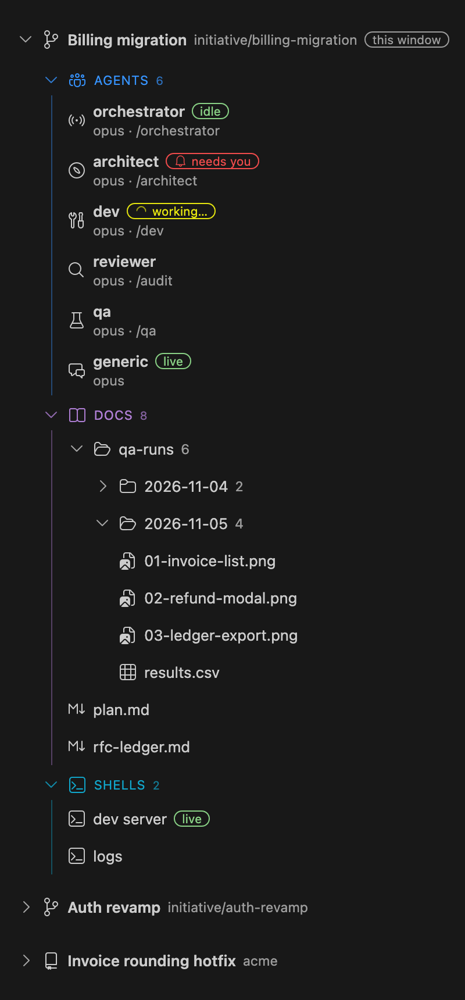

# Agent"R"Us

A VS Code sidebar for running several Claude Code agents across several pieces of work without losing track of them.



*Sample data. Regenerate with `npm run build && scripts/readme-shots/shoot.sh`.*

## Initiatives

An **initiative** is a unit of work ("Auth revamp", "Billing migration"). Each one has:

- **Agents**: Claude sessions, each with a model and an optional startup skill.
- **Docs**: notes for the initiative, kept outside the repo.
- **Shells**: plain terminals in the initiative's directory.

It runs in one of three places:

- the repo you have open;
- a new git worktree on a new branch;
- a worktree on a branch you already have.

Worktrees keep parallel initiatives out of each other's files. Agent"R"Us only ever deletes worktrees it created.

## Agents

Every initiative starts with six agents, all on `opus` by default:

| Agent | Role |
| --- | --- |
| orchestrator | Drives the initiative: starts stages, collects decisions, relays your go to dev |
| architect | Design and planning |
| dev | Implementation |
| reviewer | Code review |
| qa | Walks the feature through for real: scenarios, repros, regression passes |
| generic | Questions and odd jobs |

- The six defaults can't be removed. **Add agent** adds more, and only those can be removed.
- An initiative created before a default existed gets it on the next load.
- Clicking an agent opens its terminal and resumes its conversation where you left off.

### Status

While an agent's terminal is open, its card shows a status chip:

| Chip | Meaning |
| --- | --- |
| red bell · `needs you` | Waiting on a permission prompt or a question |
| yellow spinner · `working…` | Mid-turn |
| green · `idle` | Finished, nothing pending |
| green · `live` | Terminal open, nothing reported yet |

- Status comes from Claude hooks, via a per-agent `--settings` file. Your `~/.claude/settings.json` is never touched.
- Approving a permission prompt fires no hook, so `needs you` clears on the next tool activity. A long tool run right after approval stays on `needs you` until it finishes.
- Agents without hook state (older conversations) fall back to reading the transcript, every `agentrus.activityPollSeconds`.
- Only terminals open in this window are tracked.

### Startup skills

- A startup skill is a Claude Code skill from `~/.claude/skills/` or the repo's `.claude/skills/`.
- Every launch, first start and resume alike, sends `/<skill> docs-dir: <the initiative's docs folder>` as the first message, so the skill can write into the initiative's docs.
- An agent with no skill is asked once on first launch. "No skill" is remembered.
- Set `agentrus.skills.<agent>` to skip the question for new agents.

### Sessions

- Each conversation is named `{initiative}-{agent}`, e.g. `Auth revamp-architect`. The same name shows in the sidebar, the terminal tab and Claude's `/resume` picker.
- Whether a click starts or resumes a conversation is decided from Claude's transcripts on disk.
- Changing an agent's model keeps its conversation.
- **Start fresh session** deletes the transcript, so the agent starts over under the same name.
- Initiative names must be unique. Names that differ only in punctuation count as the same.

## Worktrees

### Creating

Choosing a worktree shows a review step before anything is created:

```
$(git-branch) Branch      initiative/auth-revamp
$(folder)     Directory   ~/Workspace/vscode-agentrus-worktrees/auth-revamp
$(git-commit) Base ref    main
──────────────────────────────
$(check) Create worktree
```

- Pick a row to change it. The directory follows the branch name until you set it yourself.
- It warns about a directory that already exists and isn't empty, or one inside the repo.
- **Existing branch** lists local and remote branches. Branches already checked out in another worktree are marked unavailable.
- Untracked files in `agentrus.copyToWorktree` (default `.env`) are copied in.
- Once the worktree is ready, it offers to open it in this window.

### Removing

- Uncommitted or untracked work gets a "discard?" prompt, and only then.
- The initiative's terminals close first, and their shells get up to five seconds to exit.
- The folder is moved aside and pruned from git, so the initiative disappears at once. The branch is deleted if you asked.
- The old files are deleted in the background. Anything left on disk is reported, with **Reveal**.
- On startup, worktrees you deleted by hand drop out of the sidebar.

## Docs

- Each initiative's docs live in the extension's storage, not in your repo. Agents get access through `--add-dir`.
- Every file in the folder shows up automatically, including ones agents write.
- **Subfolders** show as collapsible rows (QA runs with screenshots and CSVs, for example). They start collapsed and remember being opened.
- Screenshots, tables and Markdown files each get their own icon. Clicking opens the file in VS Code.
- Files and folders: **Reveal in Finder**, and **Delete** (asks first, goes to the trash).
- **Linked docs** are files from anywhere on disk. The **✕** only forgets the link.
- Hidden files and folders (names starting with `.`) stay hidden.

Removing an initiative asks what to do with its docs:

- **Archive docs**: moves them to `archive/`, with an `ARCHIVE.md` noting branch, commit, agents and sessions. An `INDEX.md` lists every archive.
- **Delete docs**: sends them to the trash.

Browse old archives with **Agent"R"Us: Open Archived Docs** or **Copy Archive Path** from the command palette.

## Usage

Open a git repository, then the Agent"R"Us view in the activity bar.

- Initiative, agent and shell cards have a **cog** with the same actions as their right-click menu.
- **`+`** creates an initiative. **Refresh** re-checks worktrees against git.
- Initiatives start collapsed, except the one this window is open on, which carries a **this window** badge.
- Reorder initiatives by dragging, or with **Move up** / **Move down**.

| Action | Where | |
| --- | --- | --- |
| Open all agents | initiative, Agents group | Esc on a skill prompt cancels the batch |
| Add agent | initiative, Agents group | A missing default, or one you name yourself |
| Remove agent | agent you added | Keeps the transcript, so re-adding resumes it |
| Change model / startup skill | agent | Applies on the next launch |
| Start fresh session | agent | Deletes the transcript |
| Open worktree in this / new window | initiative | Conversations resume on the next click |
| Add doc | initiative, Docs group | New Markdown file or a link to one |
| New shell | initiative, Shells group | |
| Rename / Remove shell | shell | |
| Add default shells | Shells group | Adds `agentrus.defaultShells` |
| Remove initiative | initiative | See [Removing](#removing) |

## Settings

| Setting | Default | |
| --- | --- | --- |
| `agentrus.models.<agent>` | `opus` | Model for new agents of that role |
| `agentrus.skills.<agent>` | — | Startup skill for new agents of that role |
| `agentrus.defaultShells` | `[]` | Shells every new initiative starts with |
| `agentrus.terminalLocation` | `panel` | `panel` or `editor` |
| `agentrus.activityPollSeconds` | `3` | Transcript fallback interval; `0` disables |
| `agentrus.worktreeRoot` | `../<repo>-worktrees` | Where worktrees are created |
| `agentrus.copyToWorktree` | `[".env"]` | Untracked files copied into new worktrees; `**/name` matches recursively |
| `agentrus.branchPrefix` | `initiative/` | Prefix for new branches |
| `agentrus.claudeCommand` | `claude` | Command that launches Claude Code |

`<agent>` is one of `orchestrator`, `architect`, `dev`, `reviewer`, `qa` or `generic`. Initiatives are stored per repository on your machine, and every worktree window of that repo sees the same list.

## Development

```sh
npm install
npm run watch    # rebuild on change
```

Press `F5` for an Extension Development Host. To install a build:

```sh
npx @vscode/vsce package --allow-missing-repository --skip-license
code --install-extension agentrus-<version>.vsix --force
```

Then run **Developer: Reload Window**.
